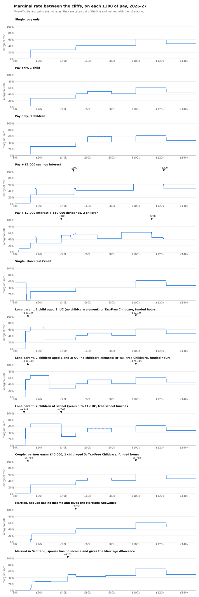

# Where earning more lowers net income (2026-27)

Generated by `harness/cliffs.py`; do not edit by hand. Net income is gross income less
income tax, employee NICs (annual basis) and the High Income Child Benefit Charge, plus
Child Benefit (53 weeks at £27.05 / £17.90), plus, where claimed, the better of Universal
Credit and Tax-Free Childcare (childcare costs £10,000 a year per child, an illustrative
assumption), plus the funded hours (England) for the children's ages, valued at DfE's
2026-27 national average local authority funding rates (£12.04 an hour under 2, £8.90 at
2, £6.61 at 3 and 4) for 38 weeks. Pay varies; everything else is fixed. Over £100,000
the working-parent hours go (30 a week under 3; the 15 on top of the universal 15 at 3
and 4); the universal 15 hours stay. Reaching the minimum earnings gains Tax-Free
Childcare and the working-parent hours, so it is a rise, not a drop.

Free school lunches (England, Education Act 1996 s512ZB) are valued at DfE's £2.66 a meal,
an illustrative value: 65 school days from 6 April to 16 August 2026, when Universal Credit
qualifies only with earned income of at most £7,400.04 a year (SI 2018/148), and 125 from
17 August 2026, when any award of Universal Credit does (s512ZB(4D)). Their cliffs are
listed by `netAllFsm_drop_only_at_steps`, found exactly by `cliffMapFsm_complete`.

The model's UC has no childcare costs element (85 % of costs up to £1,071.09 a month for
one child, £1,836.16 for two or more: SI 2013/376 regs 34 and 36). With it UC would stay
the better choice to much higher pay, so where the lone-parent households switch from UC
to Tax-Free Childcare is illustrative, not realistic. The £100,000 cliff does not depend
on it.

Every penny where net income can fall is listed by the Lean theorem
`netAll_drop_only_at_steps`, so these tables are complete within the model for each
household, at every pay. A *drop* is the fall in net income from one more penny of pay. The
*trap* is the pay range above the step where net income stays below its level just before
the step.

## Single, pay only

| kind | where (pay reaching) | drops | each drop (one-off) | trap after each step |
|---|---|---|---|---|
| personal allowance | £100,002.00 to £125,140.00 | 12,570 | £0.39 | £0.68 to £0.75 |

## Pay only, 1 child

| kind | where (pay reaching) | drops | each drop (one-off) | trap after each step |
|---|---|---|---|---|
| HICBC | £60,200.00 to £80,000.00 | 100 | £13.99 to £14.99 | £24.13 to £25.86 |
| personal allowance | £100,002.00 to £125,140.00 | 12,570 | £0.39 | £0.68 to £0.75 |

## Pay only, 3 children

| kind | where (pay reaching) | drops | each drop (one-off) | trap after each step |
|---|---|---|---|---|
| HICBC | £60,200.00 to £80,000.00 | 100 | £32.99 to £33.99 | £56.89 to £58.62 |
| personal allowance | £100,002.00 to £125,140.00 | 12,570 | £0.39 | £0.68 to £0.75 |

## Pay + £2,000 savings interest

| kind | where (pay reaching) | drops | each drop (one-off) | trap after each step |
|---|---|---|---|---|
| savings allowance | £48,270.01 to £123,140.01 | 2 | £99.99 to £199.99 | £138.88 to £377.35 |
| personal allowance | £98,002.00 to £123,140.00 | 12,570 | £0.39 | £0.68 to £378.11 |

- savings allowance: one more penny over £48,270.00 costs £99.99, once; net income is back to its level at £48,408.89 of pay.
- savings allowance: one more penny over £123,140.00 costs £199.99, once; net income is back to its level at £123,517.36 of pay.

## Pay + £2,000 interest + £10,000 dividends, 2 children

| kind | where (pay reaching) | drops | each drop (one-off) | trap after each step |
|---|---|---|---|---|
| savings allowance | £38,270.01 to £113,140.01 | 2 | £100.00 to £199.99 | £212.76 to £367.64 |
| HICBC | £48,200.00 to £68,000.00 | 100 | £22.99 to £23.99 | £39.65 to £46.15 |
| personal allowance | £88,002.00 to £113,140.00 | 12,570 | £0.39 | £0.68 to £368.38 |

- savings allowance: one more penny over £38,270.00 costs £100.00, once; net income is back to its level at £38,482.77 of pay.
- savings allowance: one more penny over £113,140.00 costs £199.99, once; net income is back to its level at £113,507.65 of pay.

## Single, Universal Credit

| kind | where (pay reaching) | drops | each drop (one-off) | trap after each step |
|---|---|---|---|---|
| personal allowance | £100,002.00 to £125,140.00 | 12,570 | £0.39 | £0.68 to £0.75 |

## Lone parent, 1 child aged 2: UC (no childcare element) or Tax-Free Childcare, funded hours

| kind | where (pay reaching) | drops | each drop (one-off) | trap after each step |
|---|---|---|---|---|
| HICBC | £60,200.00 to £80,000.00 | 100 | £13.99 to £14.99 | £24.13 to £25.86 |
| childcare (£100,000) | £100,000.01 | 1 | £12,145.99 | £30,032.07 |
| personal allowance | £100,002.00 to £125,140.00 | 12,570 | £0.39 | £0.68 to £0.75 |

- childcare (£100,000): one more penny over £100,000.00 costs £12,145.99, once; net income is back to its level at £130,032.08 of pay.
- Reaching the minimum earnings (£10,574.72) *gains* £10,146.00, once (the working-parent hours start, and Tax-Free Childcare where it beats Universal Credit).

## Lone parent, 2 children aged 1 and 3: UC (no childcare element) or Tax-Free Childcare, funded hours

| kind | where (pay reaching) | drops | each drop (one-off) | trap after each step |
|---|---|---|---|---|
| HICBC | £60,200.00 to £80,000.00 | 100 | £22.99 to £23.99 | £39.65 to £41.37 |
| childcare (£100,000) | £100,000.01 | 1 | £21,493.29 | £47,668.49 |
| personal allowance | £100,002.00 to £125,140.00 | 12,570 | £0.39 | £0.68 to £0.75 |

- childcare (£100,000): one more penny over £100,000.00 costs £21,493.29, once; net income is back to its level at £147,668.50 of pay.
- Reaching the minimum earnings (£10,574.72) *gains* £17,493.30, once (the working-parent hours start, and Tax-Free Childcare where it beats Universal Credit).

## Lone parent, 2 children at school (years 3 to 11): UC, free school lunches

| kind | where (pay reaching) | drops | each drop (one-off) | trap after each step |
|---|---|---|---|---|
| free school meals | £7,400.05 to £38,241.37 | 2 | £345.79 to £664.99 | £345.79 to £923.61 |
| HICBC | £60,200.00 to £80,000.00 | 100 | £22.99 to £23.99 | £39.65 to £41.37 |
| personal allowance | £100,002.00 to £125,140.00 | 12,570 | £0.39 | £0.68 to £0.75 |

- free school meals: one more penny over £7,400.04 costs £345.79, once; net income is back to its level at £7,745.84 of pay.
- free school meals: one more penny over £38,241.36 costs £664.99, once; net income is back to its level at £39,164.98 of pay.

## Couple, partner earns £40,000, 1 child aged 3: Tax-Free Childcare, funded hours

| kind | where (pay reaching) | drops | each drop (one-off) | trap after each step |
|---|---|---|---|---|
| HICBC | £60,200.00 to £80,000.00 | 100 | £13.99 to £14.99 | £24.13 to £25.86 |
| childcare (£100,000) | £100,000.01 | 1 | £5,767.69 | £15,177.41 |
| personal allowance | £100,002.00 to £125,140.00 | 12,570 | £0.39 | £0.68 to £0.75 |

- childcare (£100,000): one more penny over £100,000.00 costs £5,767.69, once; net income is back to its level at £115,177.42 of pay.
- Reaching the minimum earnings (£10,574.72) *gains* £5,767.71, once (the working-parent hours start, and Tax-Free Childcare where it beats Universal Credit).

## Married, spouse has no income and gives the Marriage Allowance

| kind | where (pay reaching) | drops | each drop (one-off) | trap after each step |
|---|---|---|---|---|
| personal allowance | £100,002.00 to £125,140.00 | 12,570 | £0.39 | £0.68 to £0.75 |

- Marriage Allowance: one more penny over £50,270.00 costs £251.99, once; net income is back to its level at £50,704.49 of pay.

## Married in Scotland, spouse has no income and gives the Marriage Allowance

| kind | where (pay reaching) | drops | each drop (one-off) | trap after each step |
|---|---|---|---|---|
| personal allowance | £100,002.00 to £125,140.00 | 12,570 | £0.44 | £0.84 to £0.89 |

- Marriage Allowance: one more penny over £43,662.00 costs £252.00, once; net income is back to its level at £44,166.00 of pay.

## Charts

A cliff is a one-off loss: one more penny of pay costs a fixed sum, once, and net income
then climbs back at the usual rate. It is not a rate, so the charts show it as a drop in
£, with the pay at which net income is back to where it was.

Net income against gross pay from £0 to £150,000, exact from the model every £50 and on
both sides of each cliff (table view: `net.csv`, every £1,000). The bands of small
repeated steps (the personal allowance taper, every £2; the HICBC, every £200) are
described once each rather than drawn.

The marginal rate on each £200 of pay with the one-off cliffs and gains taken out (they
are the markers, with their £ amount); the small repeated steps stay in, as the band's
average rate: 62 % from £100,000 to £125,140 with NICs. Table view: `rates.csv`.
Without benefits the rate on a penny between steps is at most 76.6 % (`net_succ_ge`);
with benefits it is at most 89.47 % (`netAll_succ_ge`: 1 - 0.45 x 0.234).

