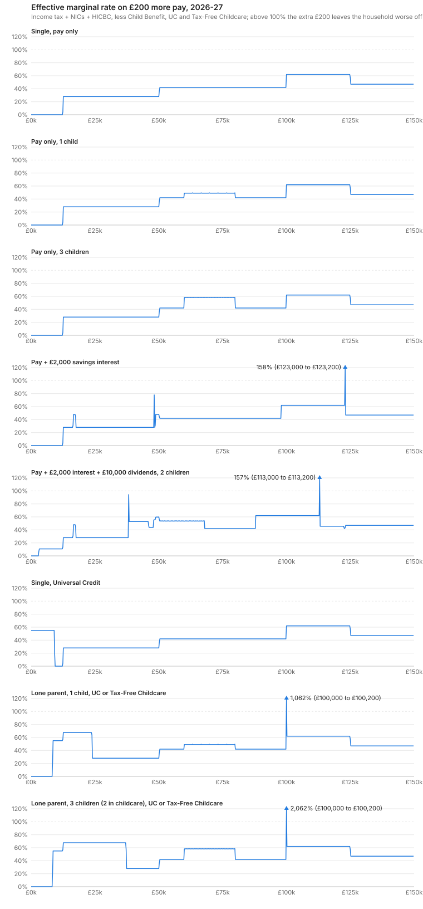

# Where earning more lowers net income (2026-27)

Generated by `harness/cliffs.py`; do not edit by hand. Net income is gross income less
income tax, employee NICs (annual basis) and the High Income Child Benefit Charge, plus
Child Benefit (52 weeks at £27.05 / £17.90), plus, where claimed, the better of Universal
Credit and Tax-Free Childcare (childcare costs £10,000 a year per child, an illustrative
assumption). Pay varies; everything else is fixed. The funded hours for working parents
are lost at the same £100,000 as Tax-Free Childcare, but they are in kind and no value is
assumed here, so their cliff is not in these tables: it adds their value to the
£100,000 drop, and lengthens the trap by about that value divided by 0.38.

Every penny where net income can fall is listed by the Lean theorem
`netAll_drop_only_at_steps`, so these tables are complete within the model for each
household, at every pay. A *drop* is the fall in net income from one more penny of pay. The
*trap* is the pay range above the step where net income stays below its level just before
the step.

## Single, pay only

| kind | where (pay reaching) | drops | each drop | trap after each step |
|---|---|---|---|---|
| personal allowance | £100,002.00 to £125,140.00 | 12,570 | £0.39 | £0.68 to £0.75 |

## Pay only, 1 child

| kind | where (pay reaching) | drops | each drop | trap after each step |
|---|---|---|---|---|
| HICBC | £60,200.00 to £80,000.00 | 100 | £13.99 to £14.99 | £24.13 to £25.86 |
| personal allowance | £100,002.00 to £125,140.00 | 12,570 | £0.39 | £0.68 to £0.75 |

## Pay only, 3 children

| kind | where (pay reaching) | drops | each drop | trap after each step |
|---|---|---|---|---|
| HICBC | £60,200.00 to £80,000.00 | 100 | £31.99 to £32.99 | £55.17 to £56.89 |
| personal allowance | £100,002.00 to £125,140.00 | 12,570 | £0.39 | £0.68 to £0.75 |

## Pay + £2,000 savings interest

| kind | where (pay reaching) | drops | each drop | trap after each step |
|---|---|---|---|---|
| savings allowance | £48,270.01 to £123,140.01 | 2 | £99.99 to £199.99 | £138.88 to £377.35 |
| personal allowance | £98,002.00 to £123,140.00 | 12,570 | £0.39 | £0.68 to £378.11 |

## Pay + £2,000 interest + £10,000 dividends, 2 children

| kind | where (pay reaching) | drops | each drop | trap after each step |
|---|---|---|---|---|
| savings allowance | £38,270.01 to £113,140.01 | 2 | £100.00 to £199.99 | £212.76 to £367.64 |
| HICBC | £48,200.00 to £68,000.00 | 100 | £22.99 to £23.99 | £39.65 to £46.15 |
| personal allowance | £88,002.00 to £113,140.00 | 12,570 | £0.39 | £0.68 to £368.38 |

## Single, Universal Credit

| kind | where (pay reaching) | drops | each drop | trap after each step |
|---|---|---|---|---|
| personal allowance | £100,002.00 to £125,140.00 | 12,570 | £0.39 | £0.68 to £0.75 |

## Lone parent, 1 child, UC or Tax-Free Childcare

| kind | where (pay reaching) | drops | each drop | trap after each step |
|---|---|---|---|---|
| HICBC | £60,200.00 to £80,000.00 | 100 | £13.99 to £14.99 | £24.13 to £25.86 |
| childcare (£100,000) | £100,000.01 | 1 | £1,999.99 | £5,262.75 |
| personal allowance | £100,002.00 to £125,140.00 | 12,570 | £0.39 | £0.68 to £0.75 |

## Lone parent, 3 children (2 in childcare), UC or Tax-Free Childcare

| kind | where (pay reaching) | drops | each drop | trap after each step |
|---|---|---|---|---|
| HICBC | £60,200.00 to £80,000.00 | 100 | £31.99 to £32.99 | £55.17 to £56.89 |
| childcare (£100,000) | £100,000.01 | 1 | £3,999.99 | £10,525.51 |
| personal allowance | £100,002.00 to £125,140.00 | 12,570 | £0.39 | £0.68 to £0.75 |

## Effective marginal rate

The rate on each £200 of pay from £0 to £150,000 is in `emr.csv` (the chart's table view);
£200 windows hold one HICBC step each, so the HICBC band shows as a level rate.
Without benefits the rate on a penny between steps is at most 76.6 % (`net_succ_ge`);
with UC tapering, 55 % of what is left on top makes at most 89.5 %. A rate above 100 % occurs only
on the step pennies above.
