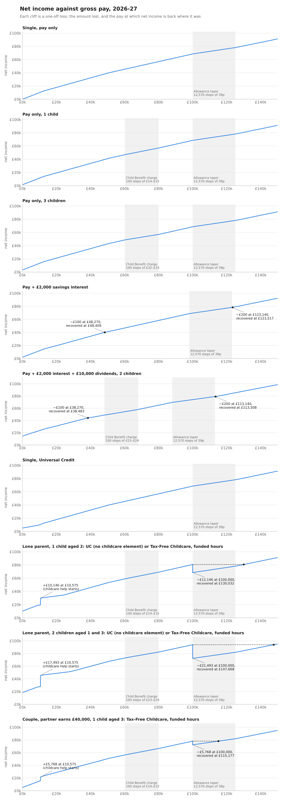
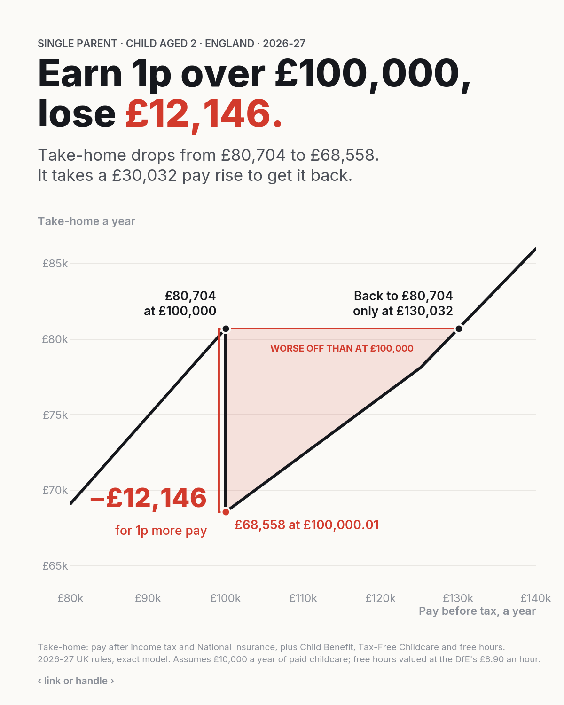

# UK tax and benefit cliffs for 2026-27, formalised in Lean

## Summary

This repository models a UK taxpayer's 2026-27 income tax (England, Wales and
Northern Ireland), employee National Insurance, the High Income Child Benefit
Charge (HICBC), a minimal Universal Credit (UC), Tax-Free Childcare and England's
funded childcare hours (valued at the Department for Education's funding rates),
in Lean 4. It proves facts about
the model, checks it against hand-worked cases, and compares it with
[PolicyEngine UK](https://github.com/PolicyEngine/policyengine-uk) 2.180.2.

The main results:

1. **The model computes the s25(2) liability exactly.** ITA 2007 s25(2) says
   allowances are deducted "in the way which will result in the greatest
   reduction in the taxpayer's liability". The model searches the allowance
   placements, and it is *proved* that the search finds the least tax for every
   income (`isLeastTax_taxExact`). As a consequence the computed liability is
   proved monotone in every kind of income (`liability_mono`).
2. **The complete list of places where earning more lowers net income is a
   theorem.** For a household whose pay varies (with any fixed savings,
   dividends, Child Benefit, pay period and benefit claims), one more penny of
   pay can lower net income only at four kinds of penny
   (`netAll_drop_only_at_steps`). The cliff map evaluates every such penny
   exactly, so it is complete within the model.
3. **The "60 % band" between £100,000 and £125,140 is a staircase of 12,570
   small cliffs**, not a smooth 60 % rate, because the tapered personal allowance
   is rounded *up* to a whole pound (ITA 2007 s35(3)).
4. **Priced at DfE's funding rates, the £100,000 childcare cliff is about six
   times the Tax-Free Childcare loss alone.** A lone parent with a 2-year-old
   loses £12,145.99 at £100,000.01 and needs £130,032.08 of pay to get back to
   where they were; with children aged 1 and 3, £21,493.29 and £147,668.50.
   A cliff is a one-off sum lost, not a rate, so the charts show it in £.
5. **PolicyEngine UK agrees** on income tax, NICs, HICBC, UC and the funded hours
   on about 18,900 cases, to within its float32 precision (plus, for NICs and UC, a documented
   gap of under half a penny). The one difference that looks like a
   PolicyEngine error is small: its monthly NIC thresholds are £1,047.50 and
   £4,189.16 where the regulations say £1,048 and £4,189, which overcharges a
   monthly-paid employee by about 48p to 60p a year.

## What is modelled

All figures for 2026-27, each cited in `UkTax/Params.lean` and the README, checked
against legislation.gov.uk and GOV.UK on 2026-11-26.

| Part | What | Main sources |
|---|---|---|
| Income tax | Non-savings, savings and dividend income; personal allowance £12,570 tapered above £100,000 and rounded up to £1; bands £37,700 / £125,140; 20 / 40 / 45 %; starting rate for savings (£5,000 at 0 %); personal savings allowance £1,000 / £500 / nil; dividend allowance £500; dividend rates 10.75 / 35.75 / 39.35 %; s25(2) allowance placement | ITA 2007 ss 6-16, 25, 35; Finance Act 2026 ss 2-4, 9-10 |
| Employee NICs | Class 1 primary, category A: 8 % from the primary threshold (£12,570 a year, £1,048 a month, £242 a week) to the upper earnings limit (£50,270 / £4,189 / £967), 2 % above; annual, monthly or weekly earnings period, equal pay each period | SSCBA 1992 s8; SI 2001/1004 regs 10-11 as amended by SI 2026/231 |
| HICBC | 1 % of Child Benefit per whole £200 of adjusted net income over £60,000, capped at 100 %; benefit, percentage and charge each rounded down | ITEPA 2003 s681C |
| Universal Credit | Standard allowance (£424.90 single, £666.97 joint, 25 or over), child element £303.94 with no two-child limit, higher work allowance £710, 55 % taper on pay less tax and NICs | SI 2013/376 regs 22, 36, 55; SI 2026/148; Universal Credit (Removal of Two Child Limit) Act 2026 |
| Childcare | Tax-Free Childcare (20 % of costs up to £2,000 a child); each parent must earn at least £2,643.68 a quarter and have adjusted net income not over £100,000 | SI 2015/448 regs 9, 15; GOV.UK |
| Funded hours (England) | Universal 15 hours a week at 3 and 4, any income; working-parent hours (30 a week from 9 months, universal included) on the same tests; 38 weeks; valued at DfE's national average local authority rates, £12.04 / £8.90 / £6.61 an hour (under 2 / 2 / 3 and 4), or a local price | Childcare Act 2006 s7, 2016 s1; SI 2022/1134 regs 14, 15, 18, 44; DfE 2026-27 technical note Table 6 |

Out of scope (see the README for the full list): Scottish rates, reliefs (pension
contributions, Gift Aid), Marriage Allowance, self-employment, UC housing,
childcare, disability and carer elements, capital and the benefit cap, couples
where both work, per-period rounding of NICs and UC, and every other tax year.

## What is proved, tested and solver-checked

Nothing is solver-checked. Every guarantee below is a Lean proof using only
Lean's core `omega` decision procedure and the standard axioms (`propext`,
`Classical.choice`, `Quot.sound`); `UkTax/Axioms.lean` fails the build if any of
them changes or a `sorry` appears. Mathlib is not used, and no SMT solver or
external certificate is involved.

### Proved (Lean)

| Theorem | Statement |
|---|---|
| `isLeastTax_taxExact` | For every income, the allowance placement the model picks gives the least Step 4 tax over every legal placement (s25(2)). |
| `liability_mono` | The computed liability never goes down when any kind of income goes up. |
| `nicExact_mono`, `hicbc_mono_income`, `hicbc_le` | NICs and the HICBC are monotone; the charge never exceeds the benefit. |
| `taxExact_succ_le` | With both allowances fixed, one more penny of pay adds at most 0.686p of income tax. |
| `net_succ_ge` | Between steps, one more penny of pay raises net income (after tax, NICs, HICBC) by at least 0.234p: the marginal rate there is at most 76.6 %. |
| `earned_plus_uc_mono`, `earned_plus_uc_gain` | Earned income plus UC never falls as earned income rises, and keeps at least 45 % of any rise. |
| `netAll_succ_ge` | Between steps, one more penny of pay raises net income with benefits by at least 0.1053p: the marginal rate there is at most 1 − 0.45 × 0.234 = 89.47 %. |
| `netAll_drop_only_at_steps` | If one more penny of pay lowers net income (with UC, Tax-Free Childcare and funded hours), it is a step of the personal allowance, the HICBC, the personal savings allowance, or adjusted net income going over £100,000. The minimum earnings test is not among them: reaching it only gains. |
| `fundedHours_over_limit`, `fundedHours_drop_at_limit` | Over £100,000 the funded hours are worth exactly the universal hours; the penny over loses exactly the working-parent hours. |

How the optimality proof works: with the income fixed, an allowance placement is
a point `(x, w)` (non-savings income left, and that plus savings left). Step 4 tax
there is a sum of band-tax terms whose arguments move by 0 or 1 per penny, so
away from a short list of lines its second difference is zero. A one-dimensional
lemma (a function with zero second difference off a set `B` is least at an end of
its interval or in `B`), applied along `x` and then along `w`, takes any legal
placement to a crossing of two lines with no more tax. Every such crossing is a
candidate the search tries.

What the proofs do *not* cover: that the model matches the law. That is the job
of the citations, the golden cases and the PolicyEngine comparison.

### Tested

- **50 golden cases** (`tests/golden.json`), each worked by hand with the working
  written down, two of them GOV.UK's own 2026-27 examples, aimed at boundaries
  (thresholds, 1p either side, rounding, s25(2) choices, the two-child limit, the
  UC/TFC choice, the £100,000 and minimum-earnings edges, each funded-hours age
  band, a partner failing either test, Wales, and net income either side of the
  £100,000 cliff). Three of the HICBC
  cases were checked by breaking the code and seeing them fail.
- **Cliff-map seed checks** (`harness/cliffs.py`), against figures worked by hand:
  every personal allowance step costs exactly 39.42p, £100,000 to £125,140 keeps
  exactly £9,553.20, the first HICBC step with one child costs £13.9942, and the
  £100,000 cliff for a lone parent with a 2-year-old costs £12,145.9942.

### Compared with PolicyEngine UK 2.180.2

| Comparison | Cases | Result |
|---|---|---|
| Income tax (unrounded) | 7,198 | all within 2 float32 steps; worst 1.13 steps (1.76p) |
| Personal allowance, savings allowance | 7,198 | all equal |
| Employee NICs | 7,198 | all within 2 float32 steps + 0.32p; largest 0.39p (3.35 steps) |
| HICBC | 7,198 | all equal |
| Universal Credit | 5,603 (2,729 paid) | all within 2 float32 steps + 0.176p; largest 0.43p (2.79 steps) |
| Funded hours | 6,090 (1,413 with working-parent hours) | 6,068 within 2 float32 steps a child, largest 0.12p; 22 differ only by PolicyEngine's disadvantaged 2-year-old hours (not modelled) |

The NIC and UC tolerances add a documented gap on top of 2 float32 steps:
0.32p for NICs (PolicyEngine's annual thresholds are 4p below the legal ones,
difference 1 below) and 0.176p for UC (55 % of that, through earned income). So
their worst cases are above 2 steps; without those gaps every case is within 2
steps.

CI runs smaller versions of the three comparisons (1,000 random cases each) on every
pull request.

## The cliff map

Full tables: [`cliffs.md`](cliffs.md). Net income here is gross income less income tax,
employee NICs and the HICBC, plus Child Benefit, the better of UC and Tax-Free
Childcare, and the funded hours at DfE rates. A *drop* is the fall in net income from one more
penny of pay; the *trap* is the pay range after it where net income stays below
its level just before the step.

A cliff is a one-off loss of a fixed sum, not a rate. Earn one penny past it and
the household is that many pounds worse off, once; above it net income climbs
again at the ordinary marginal rate until it is back where it was. Stating a
cliff as a "marginal rate" makes its size depend on how wide a slice of pay it is
spread over: the £12,146 cliff is 6,073 % of a £200 slice, 1,215 % of £1,000 and
about 40 % of £30,000. So the charts show cliffs in £, with where net income
recovers, and show rates only between them.

[`net.svg`](net.svg): net income against gross pay, £0 to £150,000, exact from
the model every £50 and on both sides of each cliff (table view
[`net.csv`](net.csv)). Each one-off cliff is labelled with the £ lost and the
recovery pay; the bands of small repeated steps (the allowance taper, the HICBC)
get one label each.

[`rates.svg`](rates.svg) shows the marginal rate on each £200 of pay with the
one-off cliffs (and the one-off gain at the childcare minimum earnings) taken
out and marked with their £ amount; the small repeated steps are averaged into
their band's rate (62 % from £100,000 to £125,140 with NICs). Table view:
[`rates.csv`](rates.csv).

[`cliff-100k.png`](cliff-100k.png) (1200 × 1500) is the lone parent with a
2-year-old on its own, from £80,000 to £140,000 of pay, for sharing.

| Step | Where | Drop | Trap | Households |
|---|---|---|---|---|
| Personal allowance (s35(3) round-up) | every £2 of total income, £100,002 to £125,140 (12,570 steps) | 39.42p each | about £0.68 each | everyone |
| HICBC | every £200, £60,200 to £80,000 (100 steps) | 1 % of the Child Benefit in whole pounds: £13.99-£14.99 (1 child), £31.99-£32.99 (3 children) | £24-£57 | with Child Benefit |
| Personal savings allowance | Step 3 income past £37,700; past £125,140 | £99.99-£100.00; £199.99 | £139-£378 | with savings interest |
| Tax-Free Childcare and working-parent hours | adjusted net income past £100,000 | £12,145.99 (lone parent, child aged 2, £10,000 of childcare), £21,493.29 (children aged 1 and 3), £5,767.69 (couple, child aged 3) | £30,032; £47,668; £15,177 | parents using childcare |

The two lone-parent households take the larger of UC and Tax-Free Childcare. The
model's UC has no childcare costs element, which would pay 85 % of childcare
costs up to £1,071.09 a month for one child (£1,836.16 for two or more)
(SI 2013/376 regs 34 and 36). With it, UC would stay the better choice to much
higher pay, so where these households switch from UC to Tax-Free Childcare is
illustrative, not realistic. The £100,000 cliff itself does not depend on it.

No other drops exist for any household of this form (pay varying; savings,
dividends, Child Benefit, claims and any partner's pay fixed). UC adds none: with the taper, the
marginal rate between steps is at most 89.47 % (`netAll_succ_ge`), and moving
between UC and Tax-Free Childcare is smooth because the household takes the
larger.

### The 60 % band is a staircase

The usual account is that the personal allowance taper gives an effective 60 %
rate between £100,000 and £125,140. That is right on average. But ITA 2007 s35(3)
says the reduced allowance "is to be rounded up to the nearest amount which is a
multiple of £1", so the allowance falls in £1 steps every £2 of income. At each
step (£100,002.00, £100,004.00, ...), the penny of income that crosses it brings
£1 of income into the 40 % band. Tax rises by 40.4p and NICs by 0.02p, so net
income falls by 39.42p. Between steps the rate is 42 % (40 % tax, 2 % NICs), and
over any whole £2 it is 62 % (60 % tax, 2 % NICs).

In money this barely matters: the worst a taxpayer can lose by being 1p over a
step is 39p. But it means "earning more always increases net income in the 60 %
band" is false at penny resolution, 12,570 times, and that a net-income function
is not monotone there. PolicyEngine models the same round-up (its personal
allowance agrees with the model's on every case), so its net income has the same
staircase.

### The £100,000 childcare cliff

Going 1p over £100,000 of adjusted net income (the parent's or the partner's)
loses Tax-Free Childcare (up to £2,000 a child) and the working-parent funded
hours. The universal 15 hours for a 3 or 4-year-old stay: they have no income test
(Childcare Act 2006 s7), which `fundedHours_over_limit` states for the model.

The hours are valued at DfE's 2026-27 national average of local authority hourly
funding rates (technical note, Table 6): £12.04 for under 2s, £8.90 for
2-year-olds and £6.61 for 3 and 4-year-olds, for 38 weeks. So the working-parent
hours are worth £13,725.60 a year for a child under 2 (30 hours), £10,146.00 at 2
(30 hours) and £3,767.70 at 3 or 4 (the 15 on top of the universal 15). These
are what the state pays local authorities for an hour; at least 97 % reaches
providers (operational guide section 4.1). DfE publishes no national figure for
the rate providers get, so this is the nearest published national figure, and the
model takes a local price per hour instead where one is given.

| household (£10,000 of childcare a child) | lost at £100,000.01 | back to the £100,000 level at pay |
|---|---|---|
| lone parent, child aged 2 | £12,145.99: TFC £2,000 + hours £10,146 | £130,032.08 |
| lone parent, children aged 1 and 3 | £21,493.29: TFC £4,000 + hours £13,725.60 + £3,767.70 | £147,668.50 |
| couple, partner earning £40,000, child aged 3 | £5,767.69: TFC £2,000 + hours £3,767.70 | £115,177.42 |

Each drop is the loss less the 0.58p the penny itself keeps. Up to £125,140 each
extra pound keeps 38p (the 60 % band and 2 % NICs), so £9,553.20 is recovered by
then; above it each pound keeps 53p (45 % and 2 %). The 2-year-old's £12,145.99
needs all of the 60 % band and then £2,592.79 / 0.53 ≈ £4,892 more:
£130,032. Before the hours were priced, the same households lost £1,999.99 and
£3,999.99 and recovered in £5,263 and £10,526 of pay.

The minimum earnings test (£2,643.68 a quarter, 16 hours at the £12.71 National
Living Wage; each parent) is not a drop: reaching it *gains* Tax-Free Childcare
and the working-parent hours. It is a jump up, so it is not in the theorem's list.
For a couple it does mean that the second earner's first £10,574.72 unlocks the
whole of both.

## Differences from PolicyEngine UK

### 1. Monthly NIC thresholds: likely a PolicyEngine error (small)

**What PolicyEngine does.** PolicyEngine works out employee NICs per month, on a
twelfth of the year's pay (`ni_class_1_employee_primary.py` and
`ni_class_1_employee_additional.py`, `definition_period = MONTH`); it has no
weekly-pay mode. Its parameter file
`parameters/gov/hmrc/national_insurance/class_1/employee_scale.yaml` stores the
2026-27 primary threshold as £241.73 a week and the upper earnings limit as
£966.73, the annual figures divided by 52, "as SI 2001/1004 reg 11(3)(c) does for
periods of whole weeks". The same comments acknowledge the statutory weekly
amounts: "The weekly amount in reg 10(c) is £242" and "The weekly amount in reg
10(b) is £967". The monthly formulas convert the weekly figure with
`threshold * WEEKS_IN_YEAR / MONTHS_IN_YEAR`, giving a monthly primary threshold
of £1,047.50 (241.73 × 52 / 12 = 1,047.497) and a monthly upper earnings limit of
£4,189.16 (966.73 × 52 / 12).

**What the law says.** For a monthly earnings period, SI 2001/1004 reg 11(3)(a)
sets the primary threshold at £1,048 and reg 11(2A)(a) the upper earnings limit
at £4,189, for 2026-27. GOV.UK's
[rates and thresholds for employers 2026 to 2027](https://www.gov.uk/guidance/rates-and-thresholds-for-employers-2026-to-2027)
lists the same: £1,048 and £4,189 a month (£242 and £967 a week, £12,570 and
£50,270 a year).

**Effect.** Checked with the model (monthly basis) and PolicyEngine 2.180.2:

| Pay | Correct NICs, monthly pay | PolicyEngine | Difference |
|---|---|---|---|
| £30,000 | £1,393.92 (£116.16 a month) | £1,394.40 (£116.20 a month) | +48p a year |
| £60,000 | £3,210.00 | £3,210.60 | +60p a year |

Below the upper earnings limit the gap is 8 % of 12 × 50p of threshold, about
48p a year; above it, the main-rate band is also wider, and the gap is about
60p. On the annual earnings-period basis (directors) PolicyEngine's thresholds
come to £12,569.96 and £50,269.96 against £12,570 and £50,270, a gap of at most
0.32p a year, which is the basis the comparison harness uses.

**Assessment.** For monthly-paid employees this looks like an error: the monthly
thresholds come from the weekly ones, which are themselves the annual figures
over 52 without the round-up to a whole pound in reg 11(4), rather than from the
monthly figures reg 11 prescribes. The amounts are small. Storing annual ÷ 52 may
be deliberate, since it makes yearly totals match the annual thresholds to
within 4p; if so, the parameter comments could say that the monthly figures are
an approximation to reg 11(3)(a) and (2A)(a).

### 2. `income_tax` includes the HICBC: by design

PolicyEngine's `income_tax` includes `CB_HITC`, through its list of Step 7 charges
(`parameters/gov/hmrc/income_tax/step_7_additional_tax.yaml`, citing ITA 2007
s30(1)). That is correct as law: Finance Act 2012 Sch 1 para 6(3) inserted
"Chapter 8 of Part 10 of ITEPA 2003 (high income child benefit charge)" into ITA
2007 s30(1), the list of amounts added at Step 7. Anyone comparing "income tax"
figures needs to know it, and the harness subtracts the charge. (PolicyEngine
cites Finance Act 2026 Sch 10 para 4(3) separately, correctly, for the winter
fuel payment charge, which that paragraph adds to the same list.)

### 3. Marriage Allowance claimed by default for couples: a default

For a one-earner couple PolicyEngine's defaults treat the couple as married and
claiming Marriage Allowance (`would_claim_marriage_allowance`), which transfers
£1,260 of allowance: £252 less tax and £138.60 more UC a year. This is a modelling
default, not an error, but a user who builds a couple without setting it gets a
claim they may not have made. The model has no Marriage Allowance, so the harness
turns it off.

### 4. Float32 precision: a limitation

PolicyEngine computes in float32, so a figure is only as precise as float32 at its
size: 0.2p at £20,000, 0.8p at £100,000, 1.6p from £131,072. Every comparison
allows 2 float32 steps, and the NIC and UC checks add the documented gaps above;
the worst seen was 1.13 steps for income tax, 3.35 steps (0.39p) for NICs and 2.79
steps (0.43p) for UC. This matters for
penny-level questions; the 39.42p staircase above is still well resolved (0.8p
steps at £100,000).

### 5. Funded hours: the same rates; two scope differences

PolicyEngine values the funded hours with the same Table 6 rates
(`parameters/gov/dfe/childcare_funding_rate.yaml`: £12.04, £8.90, £6.61 from
April 2026) over 38 weeks (`weeks_per_year.yaml`), applies the same per-parent
tests (`extended_childcare_entitlement_meets_income_requirements`: minimum wage ×
16 hours × 13 weeks a quarter, adjusted net income not over £100,000), keeps the
universal hours over £100,000, and gives nothing outside England. On 6,068 of
6,090 cases the yearly value agrees within float32 (largest difference 0.12p).

- **Disadvantaged 2-year-olds (scope).** PolicyEngine also gives the 15 hours of
  "Early Learning for 2-year-olds" (`targeted_childcare_entitlement`, £5,073 a
  year at £8.90) to a family on Universal Credit with low earnings. The model
  leaves it out. It changes the total only where the family does not also get the
  working-parent hours, since a child with both gets 15 + 15 (statutory guidance
  para A1.11): the other 22 cases, all below the minimum earnings.
- **Terms (detail).** PolicyEngine works term by term: a child counts from the
  term after its birthday, at that term's age-band rate, until it starts school.
  The model takes one band for the year, so the comparison uses children who stay
  in one band all year. A 2-year-old born in April 2024 is under 2 at the start of
  the April 2026 term, so PolicyEngine values that term at £12.04 and the year at
  £11,339.20, not £10,146. PolicyEngine is the more precise here.

### No differences found

Personal allowance (including the s35(3) round-up), personal savings allowance,
the s25(2) allowance placement for savings and dividends, HICBC (including all
three s681C(3) roundings) and the UC award agree exactly or within float32 on
every case.

## What is left

- Couples where both work beyond the childcare tests (the partner's pay is a
  fixed input there): joint UC earnings, the HICBC falling on the higher of two
  incomes, both incomes varying, and Marriage Allowance.
- Pension contributions and Gift Aid, which reduce adjusted net income and are the
  usual way out of the £100,000 cliffs.
- UC housing, childcare, disability and carer elements, capital, the benefit cap
  and the first-child rate for children born before 6 April 2017.
- Per-period rounding of NICs and UC, and weeks-in-year effects (53 Child Benefit
  Mondays in 2026-27).
- Scottish income tax, self-employment (Class 4 NICs), and 2027-28 (where the
  enacted and announced savings rates differ).
- The 15 hours for disadvantaged 2-year-olds, a child changing age band during
  the year, the childcare tests' routes for a disabled or carer partner, the lower
  minimum earnings under 21, and the other nations' childcare schemes.
- Provider-level funding rates: the model uses the national average of local
  authority rates (or a given local price), not a given authority's rate.
